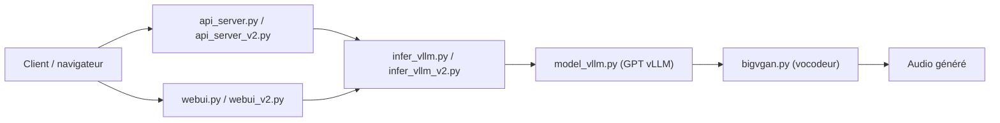

# Ksuriuri/index-tts-vllm

> Reimplementation of IndexTTS's GPT inference with vLLM to synthesize speech faster on GPU.

## The problem
IndexTTS generates speech slowly: ≈0.3 RTF and ≈90 tokens/s decoding on an RTX 4090, and concurrency is limited.

## What it actually does
Replaces the GPT stage of IndexTTS (v1, v1.5, v2) with a vLLM execution. The README claims ≈0.1 RTF and ≈280 tokens/s on a 4090, ~16 concurrent requests with ~5 GB of VRAM. Provides a WebUI, a FastAPI API (port 6006) and OpenAI-compatible routes (`/audio/speech`, `/audio/voices`). In v2, only the GPT is parallelized; s2mel remains serial (README TODO).

## How it is wired


## Trying it
```bash
git clone https://github.com/Ksuriuri/index-tts-vllm.git
cd index-tts-vllm
conda create -n index-tts-vllm python=3.12
conda activate index-tts-vllm
pip install uv
uv pip install -r requirements.txt -c overrides.txt
modelscope download --model kusuriuri/IndexTTS-2-vLLM --local_dir ./checkpoints/IndexTTS-2-vLLM
python webui_v2.py
```

## Cost and gotchas
NVIDIA GPU required; weights to download (ModelScope or Hugging Face); long first launch (CUDA compilation of bigvgan). The README admits that the v1/v1.5 and OpenAI-compatible APIs may have bugs.

## What it is not
Not a new TTS model: it is an inference accelerator for IndexTTS. No speedup across the whole v2 pipeline (s2mel not optimized). README mainly in Chinese.

## Alternatives
The README only names the upstream project index-tts (slower, but the official reference).

## For you
Worth watching: useful if you already serve IndexTTS on GPU and want throughput, but single maintainer and partly buggy API.
