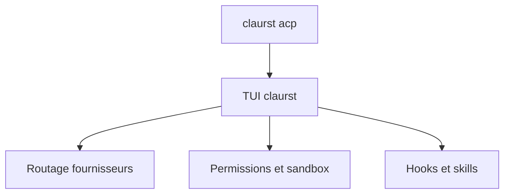

# Kuberwastaken/claurst

> Terminal coding agent written in Rust, multi-provider, reimplementing the behavior of Claude Code.

## The problem
Terminal coding agents are often tied to a single provider and closed binaries.

## What it actually does
Terminal interface with multi-provider routing, per-command permissions, a Seatbelt sandbox on macOS, hooks, `AGENTS.md` and `CLAUDE.md` files, skills, a headless mode (`stream-json`) and the ACP protocol for Zed and other editors. Several features (`/goal`, `ultracode`, `/share`, free mode) are marked experimental.

## How it is wired
Diagram not provided for this repository.


## Trying it
```bash
curl -fsSL https://github.com/kuberwastaken/claurst/releases/latest/download/install.sh | bash
npm install -g claurst
export ANTHROPIC_API_KEY=sk-ant-...
claurst
claurst -p "explain this codebase"
```

## Cost and gotchas
API key from your provider, or a ChatGPT subscription (Codex). The README states there is no tracking or telemetry. The install script is meant to be run by piping curl into bash.

## What it is not
Not stable across the board: the README announces a beta (v0.2.1) with experimental features. The "clean-room" origin is presented by the author and was not verified here.

## Alternatives
No alternative named in the README, apart from Claude Code, whose behavior it reproduces.

## For you
Worth watching: interesting for keeping a coding agent with the provider of your choice, but young, in beta and maintained by one person.
