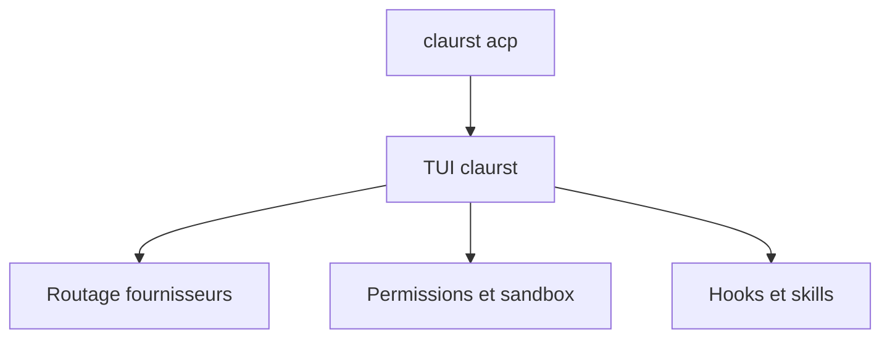

# Kuberwastaken/claurst

> Agent de code en terminal écrit en Rust, multi-fournisseurs, réimplémentant le comportement de Claude Code.

## Le problème
Les agents de code en terminal sont souvent liés à un seul fournisseur et à des binaires fermés.

## Ce que ça fait vraiment
Interface terminal avec routage multi-fournisseurs, permissions par commande, bac à sable Seatbelt sur macOS, hooks, fichiers `AGENTS.md` et `CLAUDE.md`, skills, mode headless (`stream-json`) et protocole ACP pour Zed et d'autres éditeurs. Plusieurs fonctions (`/goal`, `ultracode`, `/share`, mode gratuit) sont marquées expérimentales.

## Comment c'est branché
Diagramme non fourni pour ce dépôt.


## Essayer
```bash
curl -fsSL https://github.com/kuberwastaken/claurst/releases/latest/download/install.sh | bash
npm install -g claurst
export ANTHROPIC_API_KEY=sk-ant-...
claurst
claurst -p "explain this codebase"
```

## Coût et pièges
Clé d'API de ton fournisseur, ou abonnement ChatGPT (Codex). Le README annonce aucun suivi ni télémétrie. Le script d'installation est à exécuter par curl vers bash.

## Ce que ce n'est pas
Pas stable pour tout : le README annonce une bêta (v0.2.1) avec des fonctions expérimentales. L'origine « clean-room » est présentée par l'auteur, non vérifiée ici.

## Alternatives
Aucune alternative nommée dans le README, hormis Claude Code dont il reprend le comportement.

## Pour toi
À surveiller : intéressant pour garder un agent de code avec le fournisseur de ton choix, mais jeune, en bêta et tenu par une personne.

