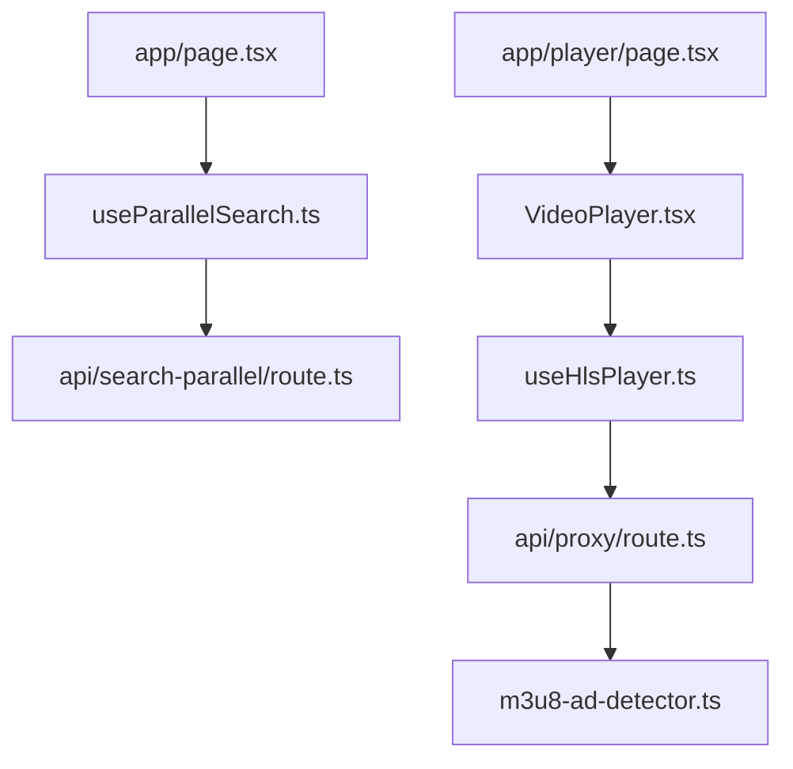

# KuekHaoYang/KVideo

> Next.js web application that aggregates video search and playback from sources you configure.

## The problem
Looking for a video means hopping from site to site, each with its own player and settings.

## What it actually does
KVideo runs a parallel search over the configured sources, streamed back (SSE), then plays HLS streams in a player with history, favorites, floating subtitles, ad filtering and IPTV. Settings can be synchronized via Upstash Redis. Android TV and Apple TV apps, simple WebView shells, are provided.

## How it is wired


## Trying it
```bash
docker pull kuekhaoyang/kvideo:latest
docker run -d -p 3000:3000 --name kvideo kuekhaoyang/kvideo:latest
docker run -d -p 3000:3000 -e ADMIN_PASSWORD=your_password --name kvideo kuekhaoyang/kvideo:latest
```

## Cost and gotchas
Free, but the repository provides no video source: it is up to you to configure sources you have the right to use. The proxy and IPTV only work with self-hosted Docker or Node.js, not on Vercel or Cloudflare. Synchronization requires an Upstash Redis.

## What it is not
Not a content catalog: without sources, the application is empty. The README is mostly in Chinese.

## Alternatives
No alternative named in the README.

## For you
Ignore: a consumer application unrelated to your work, and the legality of the sources remains your responsibility.
