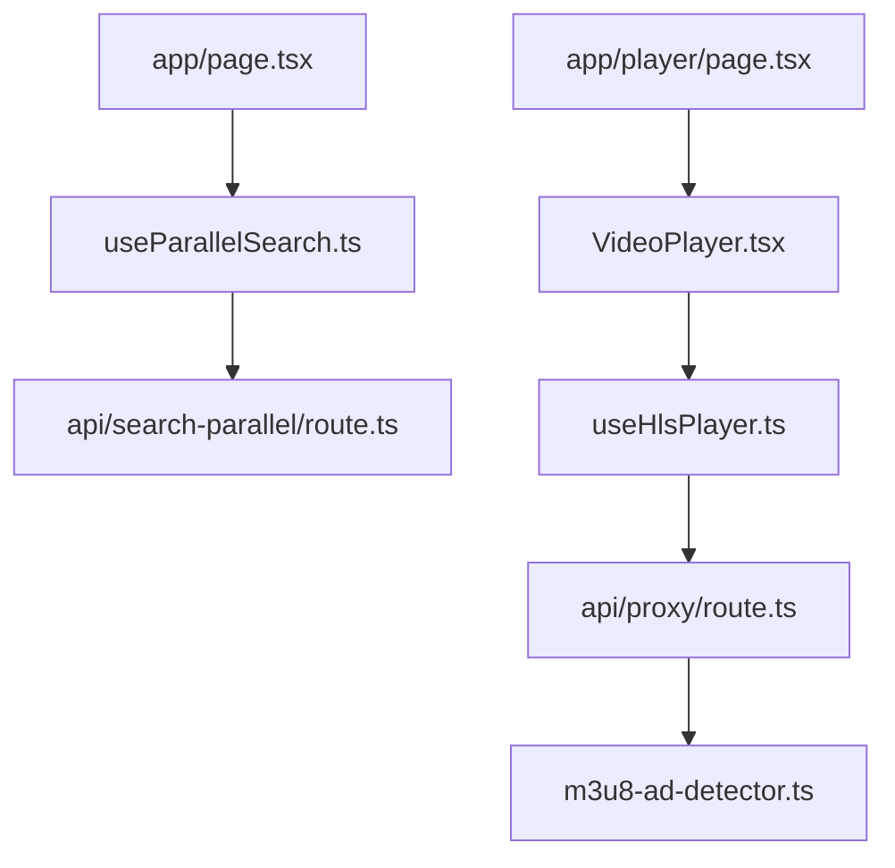

# KuekHaoYang/KVideo

> Application web Next.js qui agrège la recherche et la lecture de vidéos issues de sources que tu configures.

## Le problème
Chercher une vidéo oblige à passer d'un site à l'autre, chacun avec son lecteur et ses réglages.

## Ce que ça fait vraiment
KVideo lance une recherche parallèle sur les sources configurées, renvoyée en flux (SSE), puis lit les flux HLS dans un lecteur avec historique, favoris, sous-titres flottants, filtre de publicités et IPTV. Les réglages peuvent se synchroniser via Upstash Redis. Des applications Android TV et Apple TV, simples coques WebView, sont fournies.

## Comment c'est branché


## Essayer
```bash
docker pull kuekhaoyang/kvideo:latest
docker run -d -p 3000:3000 --name kvideo kuekhaoyang/kvideo:latest
docker run -d -p 3000:3000 -e ADMIN_PASSWORD=your_password --name kvideo kuekhaoyang/kvideo:latest
```

## Coût et pièges
Gratuit, mais le dépôt ne fournit aucune source de vidéo : à toi de configurer des sources dont tu as le droit d'usage. Le proxy et l'IPTV ne marchent qu'en Docker ou Node.js auto-hébergé, pas sur Vercel ni Cloudflare. La synchronisation demande un Redis Upstash.

## Ce que ce n'est pas
Ce n'est pas un catalogue de contenus : sans sources, l'application est vide. Le README est surtout en chinois.

## Alternatives
Aucune alternative nommée dans le README.

## Pour toi
À ignorer : application grand public sans rapport avec ton métier, et la légalité des sources reste ta responsabilité.

