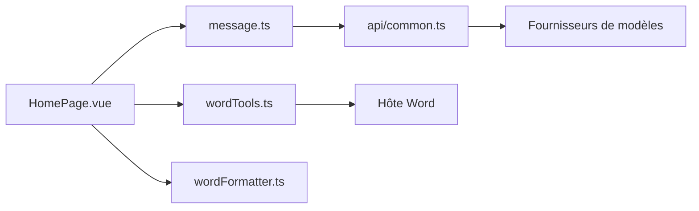

# Kuingsmile/word-GPT-Plus

> Word add-in that adds AI chat and an agent able to read and edit the document.

## The problem
Using an LLM to write or reformat in Word means copy-pasting between two windows.

## What it actually does
A Vue task pane in Word: quick actions (translate, summarize, proofread) and a LangChain agent mode with more than 25 tools (insert, replace, format, tables, bookmarks). It calls OpenAI and compatible APIs, Azure OpenAI, Gemini, Groq or Ollama. Keys stay in the add-in's local storage.

## How it is wired


## Trying it
```bash
docker pull kuingsmile/word-gpt-plus
docker run -d -p 3000:80 kuingsmile/word-gpt-plus
```

## Cost and gotchas
The chosen provider's bill is on you. Installation requires manually loading a `manifest.xml` in Word. Web search, if enabled, sends queries to a third-party service named in the README.

## What it is not
Not compatible with old `.doc` files, only `.docx`. Not a hosted service with guarantees: the "instant use" mode depends on a server run by the author.

## Alternatives
No alternative named in the README.

## For you
Worth watching: useful if you write a lot in Word; a local model via Ollama limits data exposure.
