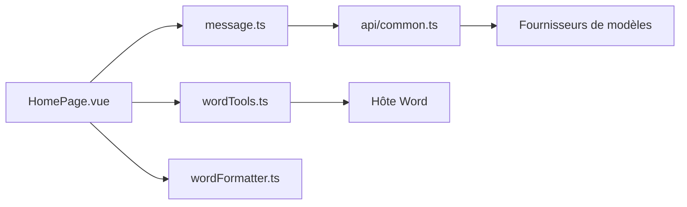

# Kuingsmile/word-GPT-Plus

> Complément Word qui ajoute chat IA et agent capable de lire et modifier le document.

## Le problème
Utiliser un LLM pour rédiger ou reformater dans Word oblige à copier-coller entre deux fenêtres.

## Ce que ça fait vraiment
Un panneau de tâches Vue dans Word : actions rapides (traduire, résumer, corriger) et mode agent LangChain avec plus de 25 outils (insérer, remplacer, formater, tables, signets). Il appelle OpenAI et compatibles, Azure OpenAI, Gemini, Groq ou Ollama. Les clés restent dans le stockage local du complément.

## Comment c'est branché


## Essayer
```bash
docker pull kuingsmile/word-gpt-plus
docker run -d -p 3000:80 kuingsmile/word-gpt-plus
```

## Coût et pièges
Facture du fournisseur choisi à ta charge. L'installation passe par le chargement manuel d'un `manifest.xml` dans Word. La recherche web, si activée, envoie les requêtes à un service tiers cité dans le README.

## Ce que ce n'est pas
Pas compatible avec les anciens `.doc`, uniquement `.docx`. Pas un service hébergé avec garanties : le mode « instant use » dépend d'un serveur de l'auteur.

## Alternatives
Aucune alternative nommée dans le README.

## Pour toi
À surveiller : utile si tu rédiges beaucoup sous Word ; le modèle local via Ollama limite l'exposition des données.

