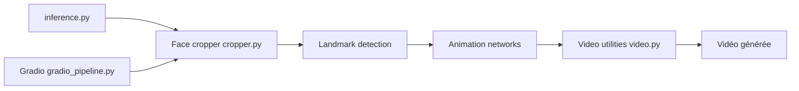

# KwaiVGI/LivePortrait

> Animates a portrait (image or video) from a driving video, official PyTorch implementation.

## The problem
Animating a still face with the expressions of a video, with fine control, requires heavy and slow models.

## What it actually does
Takes a source image/video and a driving video (or a `.pkl` motion file), crops the faces, computes the motion and generates a video. Human mode and animal mode (X-Pose, Linux/Windows with NVIDIA GPU). Gradio interface, speed evaluation, automatic cropping of the driving video.

## How it is wired


## Trying it
```bash
conda create -n LivePortrait python=3.10
pip install -r requirements.txt
huggingface-cli download KlingTeam/LivePortrait --local-dir pretrained_weights --exclude "*.git*" "README.md" "docs"
python inference.py
python app.py
```

## Cost and gotchas
NVIDIA GPU recommended (macOS: up to 20× slower); conda, FFmpeg, weights to download. License not identified by GitHub. Risk of misuse for deepfakes, acknowledged by the README.

## What it is not
Not a ready-to-use service; not designed for audio-driven lip sync.

## Alternatives
No alternative named in the README.

## For you
Good playground for video generation; clarify the license before any commercial use.
