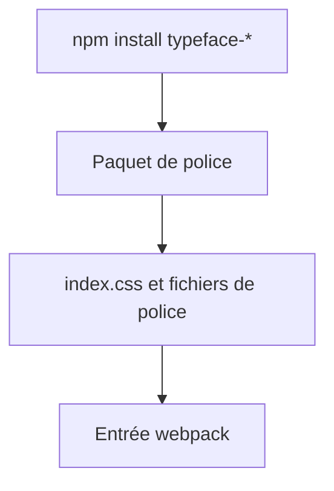

# KyleAMathews/typefaces

> npm packages of free fonts to self-host; project deprecated in favor of Fontsource.

## The problem
Loading fonts from Google Fonts adds a blocking request and breaks offline.

## What it actually does
Each font is an npm package with font files and CSS, importable through webpack (`typeface-open-sans`). All Google Fonts fonts are published, plus a few others. The README states that the packages will keep working.

## How it is wired
Simplified diagram based on the fiche, no diagram provided.


## Trying it
```bash
npm install --save typeface-open-sans
```
```javascript
require("typeface-open-sans")
```

## Cost and gotchas
Free. Deprecated project: the README asks to switch to the `@fontsource/*` packages. Last push in September 2023, license not declared.

## What it is not
Not an up-to-date solution: the author himself points to Fontsource.

## Alternatives
Fontsource (`@fontsource/*`), the replacement designated by the README.

## For you
Ignore: deprecated, use Fontsource instead.
