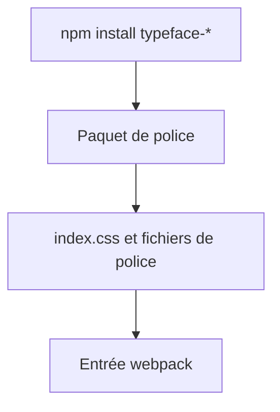

# KyleAMathews/typefaces

> Paquets npm de polices libres à héberger soi-même ; projet déprécié au profit de Fontsource.

## Le problème
Charger des polices depuis Google Fonts ajoute une requête bloquante et casse hors ligne.

## Ce que ça fait vraiment
Chaque police est un paquet npm avec fichiers de police et CSS, importable via webpack (`typeface-open-sans`). Toutes les polices Google Fonts sont publiées, plus quelques autres. Le README annonce que les paquets continueront de fonctionner.

## Comment c'est branché
Schéma simplifié d'après la fiche, sans diagramme fourni.


## Essayer
```bash
npm install --save typeface-open-sans
```
```javascript
require("typeface-open-sans")
```

## Coût et pièges
Gratuit. Projet déprécié : le README demande de passer aux paquets `@fontsource/*`. Dernier push en septembre 2023, licence non déclarée.

## Ce que ce n'est pas
Pas une solution à jour : l'auteur lui-même renvoie vers Fontsource.

## Alternatives
Fontsource (`@fontsource/*`), le remplaçant désigné par le README.

## Pour toi
Ignorer : déprécié, utiliser Fontsource à la place.

