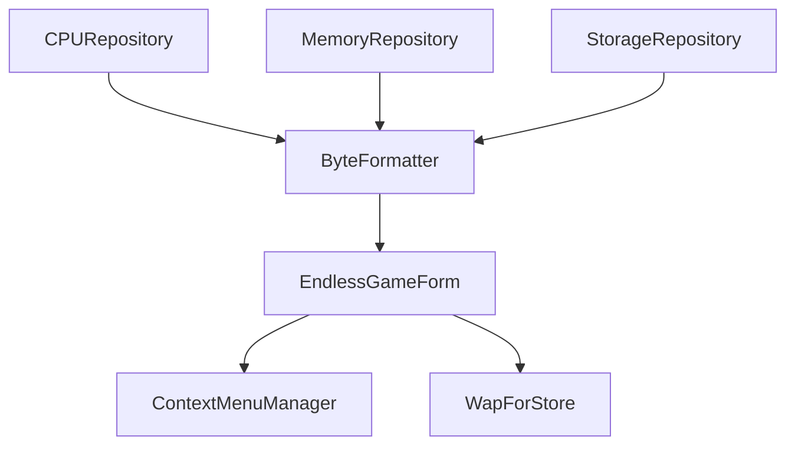

# Kyome22/RunCat365

> Animated cat running in the Windows taskbar, for those curious about their CPU load.

## The problem
Seeing the machine's activity at a glance without opening the task manager.

## What it actually does
A Windows application in C# (.NET 9.0) that displays an animated cat in the notification area. According to the architecture, metrics repositories read CPU, memory and storage, and an endless-runner game window is included. A separate project packages it for the Microsoft Store.

## How it is wired

## Trying it
No command documented: install from the Microsoft Store (https://apps.microsoft.com/detail/9nw5lpnvwfwj), Windows 10 version 19041.0 or later.

## Cost and gotchas
Free, but Windows only. Very short README: insufficient material to judge further. Issues that are not in English or do not follow the template are rejected.

## What it is not
Not a macOS version: the README explicitly refuses it. Not a serious monitoring tool.

## Alternatives
No alternative named in the README.

## For you
Ignore: a Windows desktop gadget, of no interest for data, AI or MLOps work.
