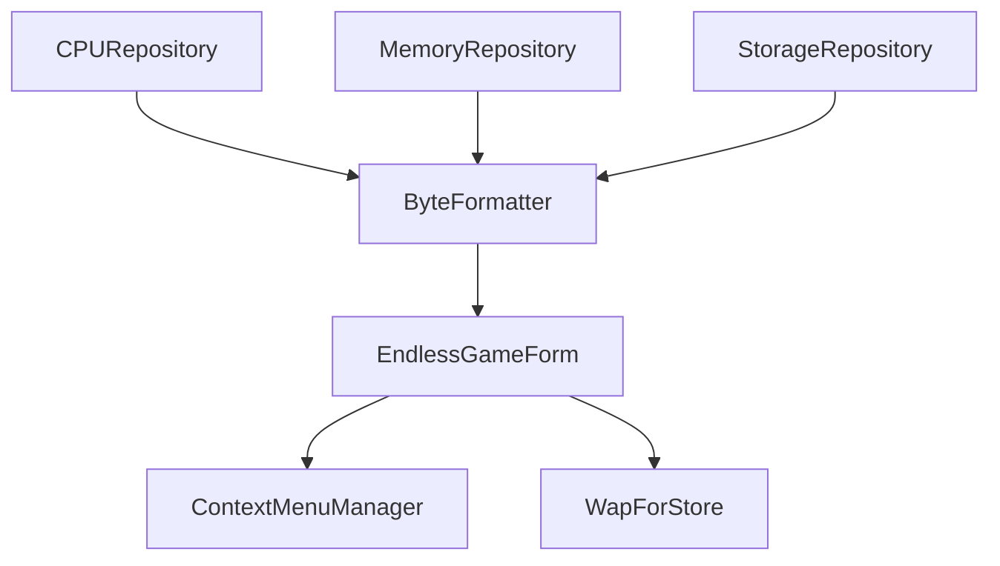

# Kyome22/RunCat365

> Animation de chat qui court dans la barre des tâches Windows, pour les curieux de leur charge CPU.

## Le problème
Voir l'activité de la machine d'un coup d'œil sans ouvrir le gestionnaire de tâches.

## Ce que ça fait vraiment
Application Windows en C# (.NET 9.0) qui affiche un chat animé dans la zone de notification. D'après l'architecture, des dépôts de métriques lisent CPU, mémoire et stockage, et une fenêtre de jeu de course sans fin est incluse. Un projet distinct sert à l'empaqueter pour le Microsoft Store.

## Comment c'est branché

## Essayer
Aucune commande documentée : installation depuis le Microsoft Store (https://apps.microsoft.com/detail/9nw5lpnvwfwj), Windows 10 version 19041.0 ou plus.

## Coût et pièges
Gratuit, mais réservé à Windows. README très court : matière insuffisante pour juger plus loin. Les issues hors anglais ou hors modèle sont refusées.

## Ce que ce n'est pas
Pas une version macOS : le README le refuse explicitement. Pas un outil de supervision sérieux.

## Alternatives
Aucune alternative nommée dans le README.

## Pour toi
À ignorer : gadget de bureau Windows, sans intérêt pour un travail data, IA ou MLOps.

