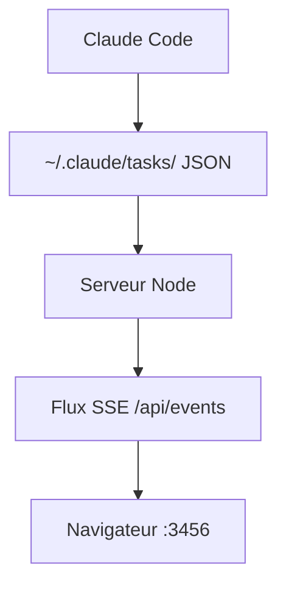

# L1AD/claude-task-viewer

> Real-time Kanban board to follow Claude Code tasks, for its users.

## The problem
The tasks Claude Code breaks work into are only visible in the terminal, with no overview across sessions.

## What it actually does
The tool watches `~/.claude/tasks/` and pushes changes to the browser via Server-Sent Events. It shows task status, their dependencies, a duration timeline, completion notifications and archiving of sessions inactive for 7 days. You can delete tasks and add notes, but not change their status.

## How it is wired


## Trying it
```bash
npx claude-task-viewer
PORT=8080 npx claude-task-viewer --open
npx claude-task-viewer --dir=~/.claude-work
```

## Cost and gotchas
Nothing to pay. The browser asks for permission to notify. Last push in February 2026: tracking of Claude Code's undocumented file format.

## What it is not
Not a control tool: Claude Code remains the owner of task state. Session export is only planned.

## Alternatives
No alternative cited in the README.

## For you
Adopt if you use Claude Code daily: a no-cost `npx` install and a clear view of what the agent is doing.
