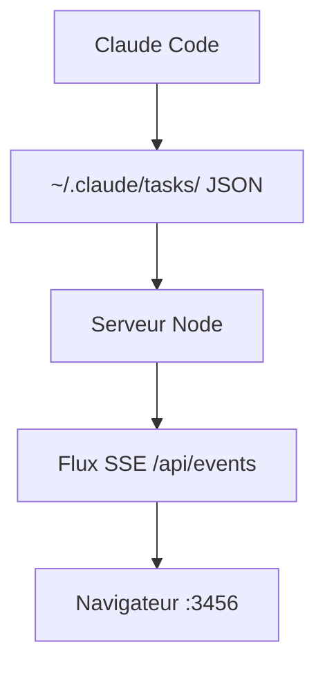

# L1AD/claude-task-viewer

> Tableau Kanban en temps réel pour suivre les tâches de Claude Code, pour ses utilisateurs.

## Le problème
Les tâches que Claude Code décompose ne sont visibles que dans le terminal, sans vue d'ensemble entre sessions.

## Ce que ça fait vraiment
L'outil surveille `~/.claude/tasks/` et pousse les changements au navigateur par Server-Sent Events. Il montre l'état des tâches, leurs dépendances, une frise de durées, des notifications de fin et l'archivage des sessions inactives depuis 7 jours. On peut supprimer des tâches et ajouter des notes, pas changer leur état.

## Comment c'est branché


## Essayer
```bash
npx claude-task-viewer
PORT=8080 npx claude-task-viewer --open
npx claude-task-viewer --dir=~/.claude-work
```

## Coût et pièges
Rien à payer. Le navigateur demande l'autorisation de notifier. Dernier push en février 2026 : suivi du format de fichiers de Claude Code non documenté.

## Ce que ce n'est pas
Pas un outil de pilotage : Claude Code reste maître de l'état des tâches. L'export de session est seulement prévu.

## Alternatives
Aucune alternative citée dans le README.

## Pour toi
À adopter si tu utilises Claude Code au quotidien : installation sans coût d'un `npx` et vue claire de ce que fait l'agent.

