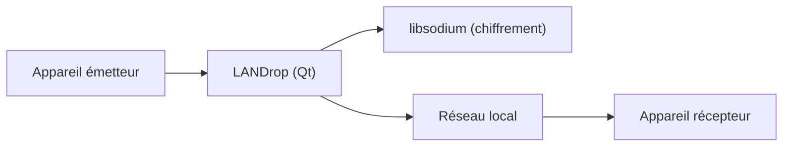

# LANDrop/LANDrop

> Cross-platform app for transferring files over the local network, for individuals.

## The problem
Sending photos or videos from one device to another often goes through a cloud, with compression and mobile data use.

## What it actually does
It transfers files over the local network between iOS, Android, macOS, Windows and Linux, without compression. The README claims modern encryption without detailing it. A personal hotspot is enough.

## How it is wired

Simplified diagram based on the fiche, no diagram provided.

## Trying it
```bash
sudo apt install libsodium-dev
git clone https://github.com/LANDrop/LANDrop
mkdir -p LANDrop/build && cd LANDrop/build
qmake ../LANDrop
make -j$(nproc)
sudo make install
landrop
```

## Cost and gotchas
Free. Build with Qt and libsodium if the Linux AppImage does not work. Last push in August 2024: follow-up uncertain.

## What it is not
It is not an internet file-sharing service: it only works on a shared local network. The encryption is not audited in the README.

## Alternatives
The README names none.

## For you
Ignore: a consumer transfer tool, unrelated to data / AI / MLOps work, and barely active.
