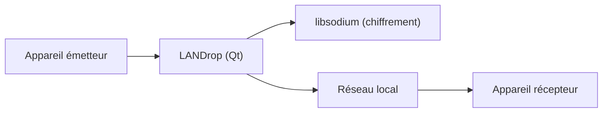

# LANDrop/LANDrop

> Application multiplateforme de transfert de fichiers sur le réseau local, pour particuliers.

## Le problème
Envoyer des photos ou vidéos d'un appareil à l'autre passe souvent par un cloud, avec compression et données mobiles.

## Ce que ça fait vraiment
Elle transfère des fichiers sur le réseau local entre iOS, Android, macOS, Windows et Linux, sans compression. Le README affirme un chiffrement moderne, sans le détailler. Un hotspot personnel suffit.

## Comment c'est branché

Schéma simplifié d'après la fiche, sans diagramme fourni.

## Essayer
```bash
sudo apt install libsodium-dev
git clone https://github.com/LANDrop/LANDrop
mkdir -p LANDrop/build && cd LANDrop/build
qmake ../LANDrop
make -j$(nproc)
sudo make install
landrop
```

## Coût et pièges
Gratuit. Compilation avec Qt et libsodium si l'AppImage Linux ne marche pas. Dernier push en août 2024 : suivi incertain.

## Ce que ce n'est pas
Ce n'est pas un service de partage via internet : il ne marche que sur un réseau local commun. Le chiffrement n'est pas audité dans le README.

## Alternatives
Le README n'en nomme aucune.

## Pour toi
À ignorer : outil grand public de transfert, sans lien avec un travail data / IA / MLOps, et peu actif.

