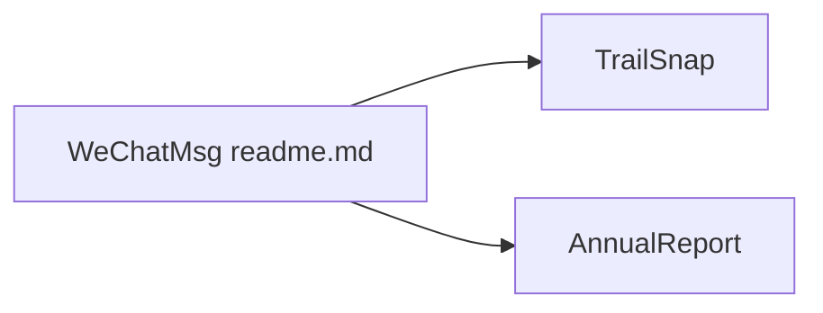

# LC044/WeChatMsg

> Repository empty of code, a former WeChat tool, now just a page pointing to other projects.

## The problem
Undocumented: the README no longer describes any working tool.

## What it actually does
Nothing executable: the tree contains only the README and images. The author announces that the project is no longer updated and points to TrailSnap (AI photo album), EasyBox and AnnualReport.

## How it is wired

## Trying it
No documented command.

## Cost and gotchas
No license declared: nothing legally reusable.

## What it is not
Not a WeChat message exporter, despite the name and the stars.

## Alternatives
None named.

## For you
The repository no longer contains any code, only pointers to other projects: nothing to take. Ignore.
