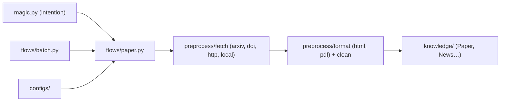

# LLMQuant/quant-mind

> Python library that turns financial papers and news into typed, cited knowledge.

## The problem
Raw financial information (papers, news wires) is hard for a RAG to use: no source, no date, no structure.

## What it actually does
`PaperFlow` turns an arXiv paper into a paginated structure tree or into chunks plus a cited summary. `collect_news` collects windows of news wires, `batch_run` handles concurrency, `magic` turns a free-form instruction into a configuration. Each artifact carries text, an `as_of` date and a source reference. The repository is also designed to be "opened" by an agent (AGENTS.md/CLAUDE.md contracts, `scripts/verify.sh`). The agentic research module `mind/` is announced but absent from the tree; evaluation is "in design".

## How it is wired


## Trying it
```bash
uv venv && source .venv/bin/activate
uv pip install -e .
git clone https://github.com/LLMQuant/quant-mind.git
cd quant-mind && claude
```

## Cost and gotchas
The examples call a model through an API (key at your expense). Some model names in the README are specific to the author. No published evaluation results.

## What it is not
Not yet a retrieval engine: the search part is announced. The hosted product LLMQuant Data is separate.

## Alternatives
Not documented in the README.

## For you
Keep an eye on it: the idea of dated, cited knowledge suits quantitative finance, but the API is still moving and the search part does not exist.
