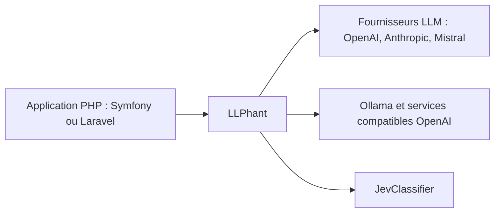

# LLPhant/LLPhant

> A PHP library for generative AI applications and vector databases, compatible with Symfony and Laravel.

## The problem
PHP developers lack a simple library to call LLMs, do RAG and use a vector database without leaving their framework.

## What it actually does
LLPhant offers a simple interface to OpenAI, Anthropic, Mistral, Ollama, LM Studio and OpenAI-compatible services such as LocalAI. The README highlights JevClassifier (typed classification, prompt injection detection in QuestionAnswering), whose code was extracted into the Jev-PHP library. The detail of the features (RAG, vectors) is in the online documentation, not in the README.

## How it is wired
Simplified diagram based on the fiche, no diagram provided.



## Trying it
```bash
composer require theodo-group/llphant
composer require theodo-group/llphant --ignore-platform-req=ext-gd
composer require theodo-group/llphant:dev-main
export JEV_API_KEY=your_api_key
```

## Cost and gotchas
PHP 8.1+ required, GD extension recommended. API key of the chosen provider, billed by them; JevClassifier needs its own JEV_API_KEY key. The README gives no cost figures.

## What it is not
Not a full agent platform nor an equivalent of LangChain in capabilities: it is a lightweight library for PHP. The supported vector databases are not listed in the README.

## Alternatives
- LangChain: the reference mentioned as a source of inspiration, outside the PHP ecosystem.
- LlamaIndex: same, centered on RAG in Python.

## For you
Worth watching: useful if your application stack is PHP and you want to add RAG without changing language; otherwise the Python tools remain richer.
