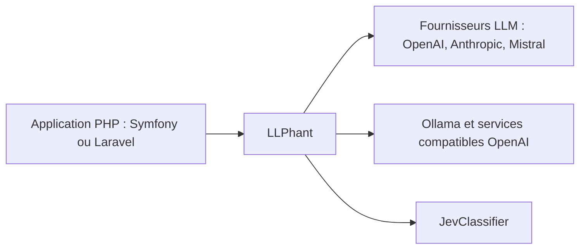

# LLPhant/LLPhant

> Bibliothèque PHP pour applications d'IA générative et bases vectorielles, compatible Symfony et Laravel.

## Le problème
Les développeurs PHP n'ont pas de bibliothèque simple pour appeler des LLM, faire du RAG et utiliser une base vectorielle sans quitter leur framework.

## Ce que ça fait vraiment
LLPhant propose une interface simple vers OpenAI, Anthropic, Mistral, Ollama, LM Studio et des services compatibles OpenAI comme LocalAI. Le README met en avant JevClassifier (classification typée, détection d'injection de prompt dans QuestionAnswering), dont le code a été extrait vers la bibliothèque Jev-PHP. Le détail des fonctions (RAG, vecteurs) est dans la documentation en ligne, pas dans le README.

## Comment c'est branché
Schéma simplifié d'après la fiche, sans diagramme fourni.



## Essayer
```bash
composer require theodo-group/llphant
composer require theodo-group/llphant --ignore-platform-req=ext-gd
composer require theodo-group/llphant:dev-main
export JEV_API_KEY=your_api_key
```

## Coût et pièges
PHP 8.1+ requis, extension GD conseillée. Clé d'API du fournisseur choisi, facturée chez lui ; JevClassifier demande sa propre clé JEV_API_KEY. Le README ne chiffre aucun coût.

## Ce que ce n'est pas
Pas une plateforme d'agents complète ni un équivalent de LangChain en capacités : c'est une bibliothèque légère pour PHP. Les bases vectorielles prises en charge ne sont pas listées dans le README.

## Alternatives
- LangChain : référence mentionnée comme source d'inspiration, hors écosystème PHP.
- LlamaIndex : idem, centré sur le RAG en Python.

## Pour toi
À surveiller : utile si ta stack applicative est en PHP et que tu veux ajouter du RAG sans changer de langage ; sinon les outils Python restent plus riches.

