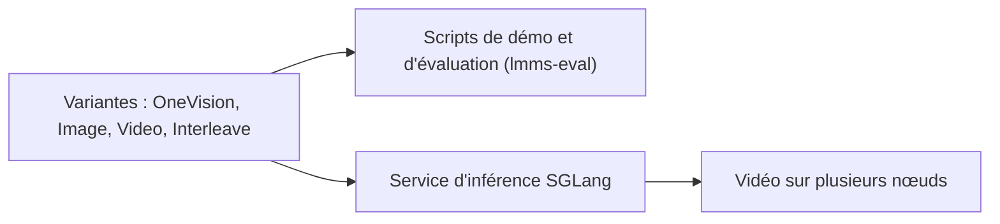

# LLaVA-NeXT

> Family of open multimodal models (image, multi-image, video) with inference and evaluation code.

## The problem
You need open vision-language models, also capable of video and multi-image, with reproducible inference scripts.

## What it actually does
Groups the LLaVA-OneVision, LLaVA-NeXT-Image, -Video and -Interleave variants, with demo and evaluation scripts (via lmms-eval). Accelerated serving goes through SGLang, including video across several nodes. Details are in linked pages, not reproduced in this README.

## How it is wired
Simplified diagram based on the sheet, no diagram provided.

No diagram provided. The README describes a single repo with sub-projects per modality (OneVision, Image, Video, Interleave), with inference serving delegated to SGLang.

## Trying it
```bash
git clone https://github.com/LLaVA-VL/LLaVA-NeXT
cd LLaVA-NeXT
conda create -n llava python=3.10 -y
conda activate llava
pip install --upgrade pip
pip install -e ".[train]"
```

## Cost and gotchas
A GPU is needed in practice (not quantified in the README). A second repo, SGLang, is required for serving. 355 open issues.

## What it is not
Not a ready-to-use application: the README points to sub-pages for usage. No inference example appears in it.

## Alternatives
SGLang, named for serving acceleration; lmms-eval for evaluation.

## For you
Worth watching: a useful reference for open multimodal, but the README is thin; check the state of the weights and updates before building on it.
