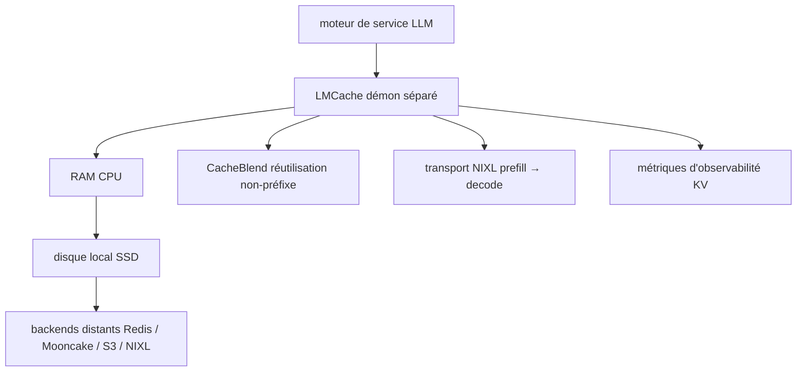

# LMCache/LMCache

> KV cache management layer for LLM servers, to reduce TTFT on long contexts.

## The problem
The KV cache lives and dies with the inference engine process: one crash, and the entire prefill has to be recomputed.
In RAG, multi-turn or agentic workloads, the same prefixes are recomputed over and over.

## What it actually does
Runs as a daemon separate from the inference engine, so the KV cache survives an engine crash.
Offloads the KV cache out of GPU memory into a hierarchy: CPU RAM, local disk, then remote backends (Redis/Valkey, Mooncake, InfiniStore, S3, NIXL, GDS).
Reuses KV blocks beyond prefixes thanks to CacheBlend, selectively recomputing tokens to recover quality.
Transfers KV from prefill workers to decode workers (PD disaggregation) over NVLink, RDMA or TCP, and exposes cache metrics (prefix hits per request and per token, lifecycle, per-user usage).

## How it is wired


## Trying it
```bash
pip install lmcache
```

## Cost and gotchas
Free, but the value assumes a GPU inference infrastructure already in place, and a storage backend to provision.
The README gives only one install command: all the real configuration lives in the Installation, Quickstart and Production Deployment pages.

## What it is not
Not an inference engine: it slots under an existing engine, it does not serve a model.
Not a database: the reused KV cache is not a queryable semantic memory.
Not a single-vendor project — neutrality is claimed — but its development is partly supported by Tensormesh.

## Alternatives
No alternative named; the repositories cited (Mooncake, InfiniStore, NIXL) are backends, not replacements.

## For you
Worth following closely if you serve long-context LLMs: it is the most direct latency lever after batching.
