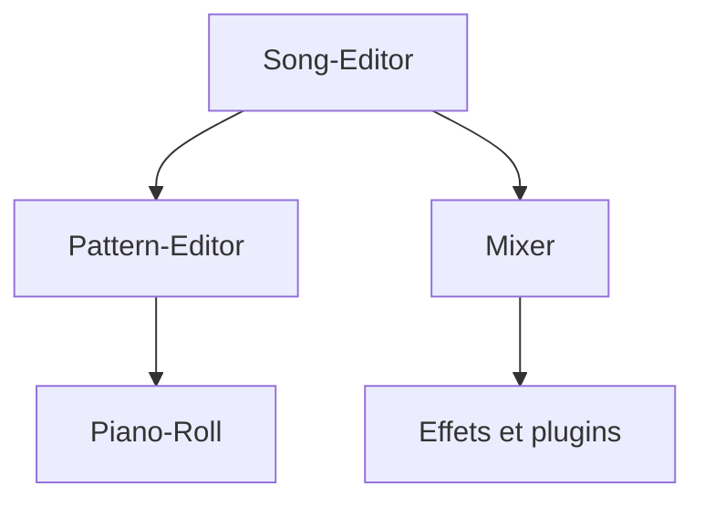

# LMMS/lmms

> Free, cross-platform digital audio workstation for composing, arranging and mixing music.

## The problem
Producing music on a computer without commercial software.

## What it actually does
Song editor, pattern editor, piano roll and a mixer with unlimited channels. More than fifteen bundled synthesizers, support for VST2, SoundFont2, LADSPA, LV2, MIDI import and export, automation.

## How it is wired
No diagram provided for this repository; the architecture is not documented in the available material.

## Trying it
No command documented in the README: building is described on the wiki ("Compiling LMMS").

## Cost and gotchas
Free. Build from source per the wiki; the README does not detail binaries.

## What it is not
Not an AI or data tool. Feature requests go through an issue first (1,496 open).

## Alternatives
No alternative named in the README.

## For you
Ignore: music production software, unrelated to data, AI or MLOps.
