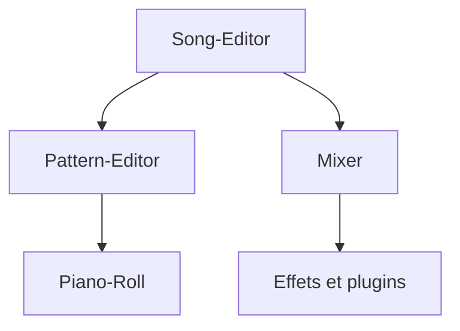

# LMMS/lmms

> Station audio numérique libre et multiplateforme pour composer, arranger et mixer de la musique.

## Le problème
Produire de la musique sur ordinateur sans logiciel commercial.

## Ce que ça fait vraiment
Éditeur de morceaux, éditeur de motifs, piano roll et mixeur à canaux illimités. Plus de quinze synthétiseurs fournis, prise en charge de VST2, SoundFont2, LADSPA, LV2, import et export MIDI, automation.

## Comment c'est branché
Diagramme non fourni pour ce dépôt ; l'architecture n'est pas documentée dans la matière disponible.

## Essayer
Aucune commande documentée dans le README : la compilation est décrite sur le wiki (« Compiling LMMS »).

## Coût et pièges
Gratuit. Compilation depuis les sources selon le wiki ; le README ne détaille pas les binaires.

## Ce que ce n'est pas
Pas un outil d'IA ni de données. Les demandes de fonctionnalités passent d'abord par une issue (1 496 ouvertes).

## Alternatives
Aucune alternative nommée dans le README.

## Pour toi
À ignorer : logiciel de production musicale, sans lien avec data, IA ou MLOps.

