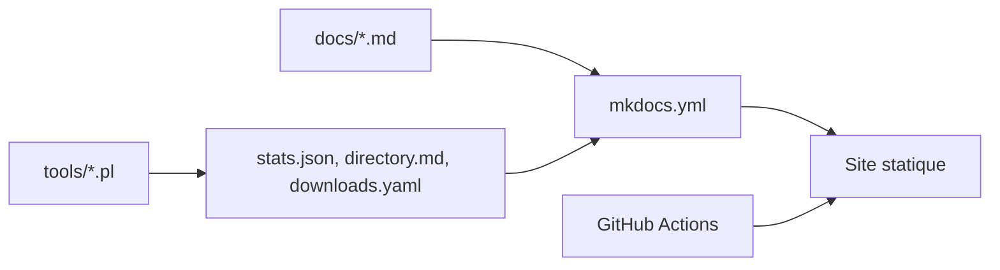

# LMS-Community/lms-community.github.io

> Source of the LMS community's lyrion.org website, built with mkdocs-material.

## The problem
The community needs a documentation site maintained by contributors, with up-to-date plugin and download pages.

## What it actually does
The site is written in Markdown under `docs/` and generated by mkdocs-material. Perl scripts in `tools/` produce the statistics, the plugin directory and the downloads page, updated at deployment. A GitHub Actions workflow publishes the site.

## How it is wired
Simplified diagram based on the fiche, no diagram provided.



## Trying it
```bash
docker build -t mkdocs-material-with-plugins .
docker run --rm -it -p 8000:8000 -v ${PWD}:/docs mkdocs-material-with-plugins
mkdocs serve
```

## Cost and gotchas
Free. No license is declared, so reuse of the content is not clearly permitted.

## What it is not
Not software: it is the content of a website. The README does not describe the LMS server itself.

## Alternatives
No alternative named in the README.

## For you
Ignore: source of a documentation site unrelated to data or AI, with no clear license.
