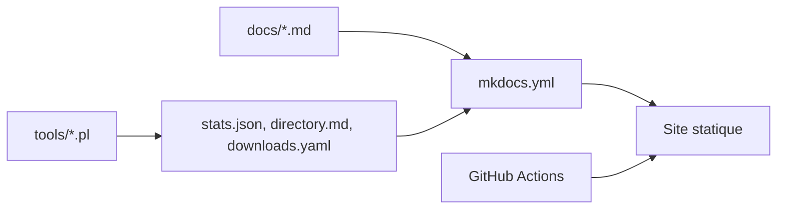

# LMS-Community/lms-community.github.io

> Source du site web lyrion.org de la communauté LMS, construit avec mkdocs-material.

## Le problème
La communauté a besoin d'un site de documentation maintenu par des contributeurs, avec des pages de plugins et de téléchargements à jour.

## Ce que ça fait vraiment
Le site est écrit en Markdown sous `docs/` et généré par mkdocs-material. Des scripts Perl dans `tools/` produisent les statistiques, le répertoire de plugins et la page de téléchargements, mis à jour au déploiement. Un workflow GitHub Actions publie le site.

## Comment c'est branché
Schéma simplifié d'après la fiche, sans diagramme fourni.



## Essayer
```bash
docker build -t mkdocs-material-with-plugins .
docker run --rm -it -p 8000:8000 -v ${PWD}:/docs mkdocs-material-with-plugins
mkdocs serve
```

## Coût et pièges
Gratuit. Aucune licence n'est déclarée, donc la réutilisation du contenu n'est pas clairement permise.

## Ce que ce n'est pas
Pas un logiciel : c'est le contenu d'un site. Le README ne décrit pas le serveur LMS lui-même.

## Alternatives
Aucune alternative nommée dans le README.

## Pour toi
À ignorer : source d'un site de documentation sans rapport avec la data ou l'IA, sans licence claire.

