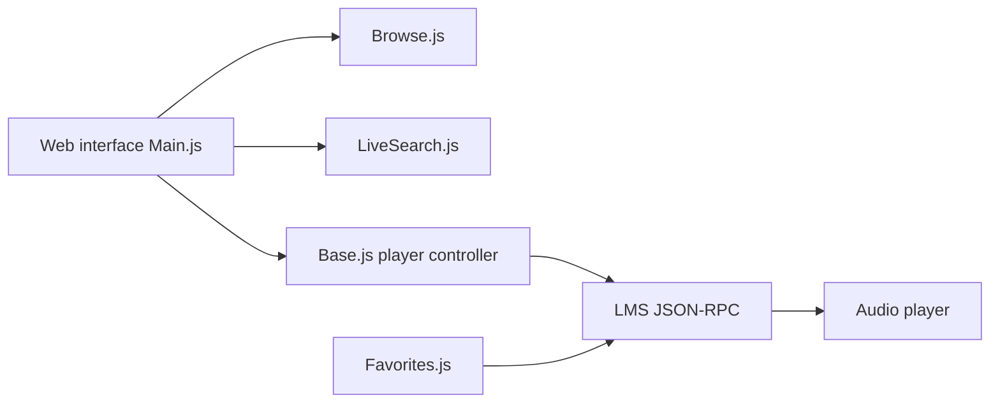

# LMS-Community/slimserver

> The Lyrion Music Server (formerly SlimServer) audio server in Perl, which streams local music and web services to Squeezebox players.

## The problem
Stream a music library and radio stations to several network players, with a lightweight server on any machine.

## What it actually does
Serves local music and, via plugins, streaming services and Internet radios to Logitech/Squeezebox players or emulators (Squeezelite, SqueezePlay). Written in Perl, runs on Linux, macOS, Windows and on Raspberry Pi or NAS. The described architecture only covers the web interface (Main.js, Browse.js, LiveSearch.js), not the server runtime.

## How it is wired


## Trying it
```bash
# Aucune commande dans le README : voir la documentation « Getting started ».
```

## Cost and gotchas
Free. Mostly useful with compatible Squeezebox hardware or client.

## What it is not
Not a data/AI tool. The README documents no installation command. A license is present but not identified by GitHub.

## Alternatives
No alternative named in the README.

## For you
Ignore for a data/AI/MLOps profile: it is a home music server, unrelated to your field.
