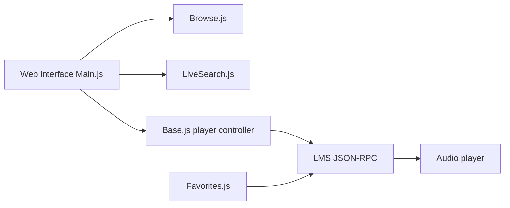

# LMS-Community/slimserver

> Serveur audio Lyrion Music Server (ex-SlimServer) en Perl, qui diffuse musique locale et services web vers lecteurs Squeezebox.

## Le problème
Streamer une bibliothèque musicale et des radios vers plusieurs lecteurs réseau, avec un serveur léger sur n'importe quelle machine.

## Ce que ça fait vraiment
Sert la musique locale et, via plugins, des services de streaming et radios Internet à des lecteurs Logitech/Squeezebox ou émulateurs (Squeezelite, SqueezePlay). Écrit en Perl, tourne sous Linux, macOS, Windows et sur Raspberry Pi ou NAS. L'architecture décrite ne couvre que l'interface web (Main.js, Browse.js, LiveSearch.js), pas le runtime serveur.

## Comment c'est branché


## Essayer
```bash
# Aucune commande dans le README : voir la documentation « Getting started ».
```

## Coût et pièges
Gratuit. Utile surtout avec du matériel ou un client Squeezebox compatible.

## Ce que ce n'est pas
Pas un outil data/IA. Le README ne documente aucune commande d'installation. Licence présente mais non identifiée par GitHub.

## Alternatives
Aucune alternative nommée dans le README.

## Pour toi
À ignorer pour un profil data/IA/MLOps : c'est un serveur musical domestique, sans lien avec ton métier.

