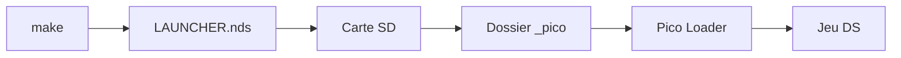

# LNH-team/pico-launcher

> Launcher for the Nintendo DS that loads games and homebrews via Pico Loader.

## The problem
Choosing and starting games on a DS console with a flash cartridge without a convenient menu.

## What it actually does
Interface with an icon grid, banner list or coverflow, Material Design 3 themes, custom icons and covers, background music and cheats. It relies on the Pico Loader files present on the SD card.

## How it is wired
Simplified diagram based on the sheet, no diagram provided.


## Trying it
```bash
make
# copier LAUNCHER.nds sur la carte SD
# DSpico : renommer en _picoboot.nds à la racine, copier le dossier _pico
```

## Cost and gotchas
Free. Requires BlocksDS; WSL or MSYS2 recommended. The Pico Loader files must be in `/_pico`. DSiWare needs extra files.

## What it is not
Not an emulator nor a game provider: a launch menu. Console hardware required.

## Alternatives
No alternative named in the README.

## For you
Ignore: console tinkering project, unrelated to data/AI/MLOps.
