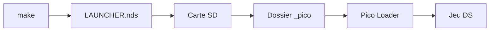

# LNH-team/pico-launcher

> Lanceur pour Nintendo DS qui charge des jeux et homebrews via Pico Loader.

## Le problème
Choisir et démarrer des jeux sur une console DS avec une cartouche flash sans menu pratique.

## Ce que ça fait vraiment
Interface avec grille d'icônes, liste de bannières ou coverflow, thèmes Material Design 3, icônes et jaquettes personnalisées, musique de fond et astuces (cheats). Il s'appuie sur les fichiers de Pico Loader présents sur la carte SD.

## Comment c'est branché
Schéma simplifié d'après la fiche, sans diagramme fourni.


## Essayer
```bash
make
# copier LAUNCHER.nds sur la carte SD
# DSpico : renommer en _picoboot.nds à la racine, copier le dossier _pico
```

## Coût et pièges
Gratuit. Demande BlocksDS ; WSL ou MSYS2 conseillés. Les fichiers Pico Loader doivent être dans `/_pico`. Le DSiWare réclame des fichiers en plus.

## Ce que ce n'est pas
Pas un émulateur ni un fournisseur de jeux : un menu de lancement. Matériel de console requis.

## Alternatives
Aucune alternative nommée dans le README.

## Pour toi
À ignorer : projet de bricolage console, sans rapport avec data/IA/MLOps.

