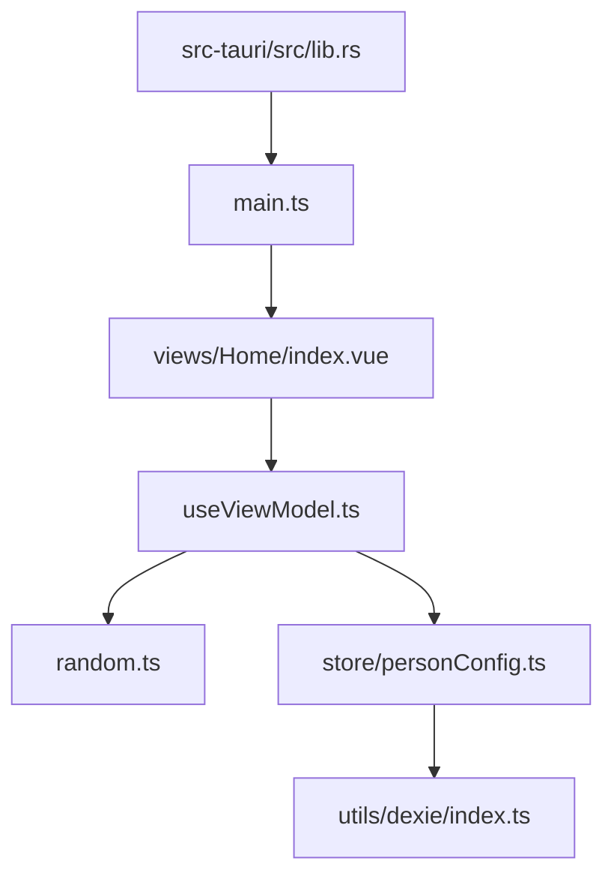

# LOG1997/log-lottery

> Configurable 3D-sphere prize draw application, for livening up company parties.

## The problem
Running an event prize draw with a participant list, prizes and staging without hacking something together.

## What it actually does
Vue 3 application with a Three.js sphere: you import participants from Excel, configure prizes, interface, images and music, and export the results. Data stays in the browser (IndexedDB via Dexie). Docker version, Windows installer (Tauri) and an optional Rust WebSocket server.

## How it is wired


## Trying it
```bash
pnpm i
pnpm dev
docker run -d --name log-lottery -p 9279:80 log1997/log-lottery:latest
```

## Cost and gotchas
Free. Node for development, Docker optional. Recent Chrome or Edge on PC required; README in Chinese; the author warns that bugs are possible.

## What it is not
Not a rigging tool ("no directed draw function"). Not cross-platform for the installer: Windows only.

## Alternatives
No alternative cited in the README.

## For you
Ignore: an event entertainment tool, unrelated to data, AI or MLOps work.
