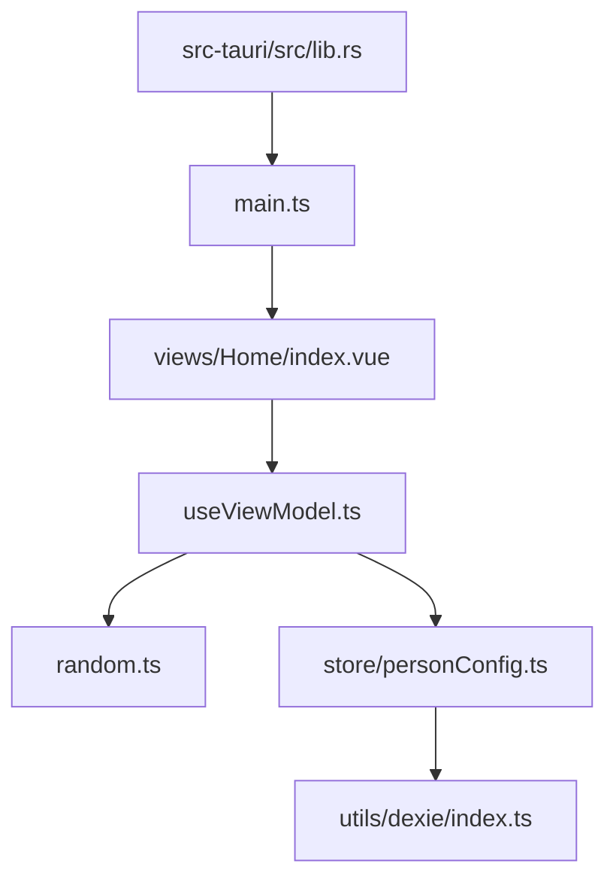

# LOG1997/log-lottery

> Application de tirage au sort en sphère 3D configurable, pour animer des soirées d'entreprise.

## Le problème
Organiser un tirage au sort d'événement avec liste de participants, lots et mise en scène sans bricoler.

## Ce que ça fait vraiment
Application Vue 3 avec sphère Three.js : on importe les participants par Excel, on configure prix, interface, images et musique, on exporte les résultats. Les données restent dans le navigateur (IndexedDB via Dexie). Version Docker, installeur Windows (Tauri) et serveur WebSocket Rust optionnel.

## Comment c'est branché


## Essayer
```bash
pnpm i
pnpm dev
docker run -d --name log-lottery -p 9279:80 log1997/log-lottery:latest
```

## Coût et pièges
Gratuit. Node pour le développement, Docker en option. Chrome ou Edge récents sur PC requis ; README en chinois ; l'auteur prévient que des bugs sont possibles.

## Ce que ce n'est pas
Pas un outil truquable (« pas de fonction de tirage dirigé »). Pas multi-plateforme pour l'installeur : Windows seulement.

## Alternatives
Aucune alternative citée dans le README.

## Pour toi
Ignorer : outil d'animation événementielle, sans rapport avec un travail data, IA ou MLOps.

