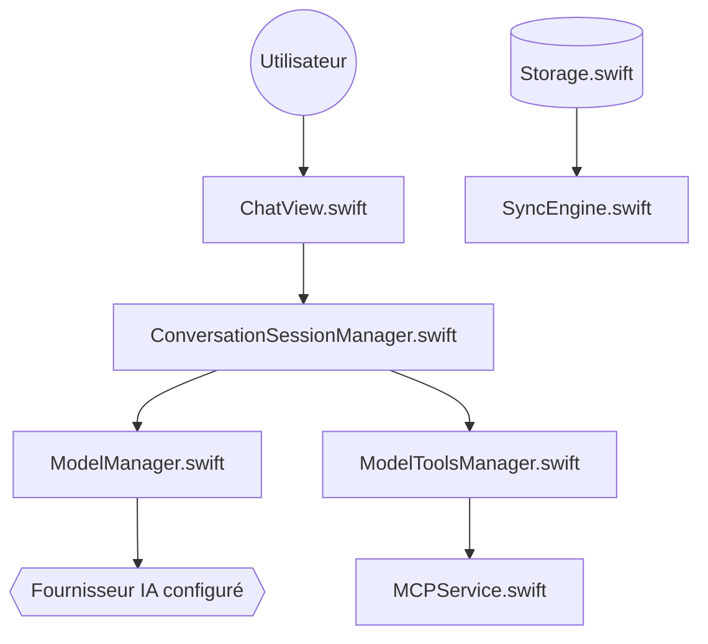

# Lakr233/FlowDown

> Native AI chat client for iPhone, iPad and Mac, which sends no data to the developer.

## The problem
Official AI chat clients centralize your data and do not let you plug in your own models.

## What it actually does
Swift and UIKit chat connected to any OpenAI-compatible service, to local servers (Ollama, LM Studio, LocalAI), to Apple Intelligence or to a local MLX model. Attachments, vision, audio, web search, tools and MCP connections, prompt templates, iCloud sync, Shortcuts intents and a translation app. The README claims zero collection and no telemetry.

## How it is wired


## Trying it
```bash
# Aucune commande : application à installer depuis l'App Store ou TestFlight,
# puis ajouter un modèle (Apple Intelligence, MLX local ou fournisseur compatible OpenAI).
```

## Cost and gotchas
Pricing is being lowered, with a move to free announced and a future subscription for customization. Remote models cost according to your provider. You must configure and test it yourself, model by model.

## What it is not
Not a model nor a service: it is only the interface. Restricted to the Apple ecosystem. AGPL license, not flagged here by default.

## Alternatives
No alternative named in the README (Ollama, LM Studio, LocalAI are cited as backends).

## For you
Worth watching: handy for testing your local or OpenAI-compatible models from Apple devices, provided you do not need another platform.
