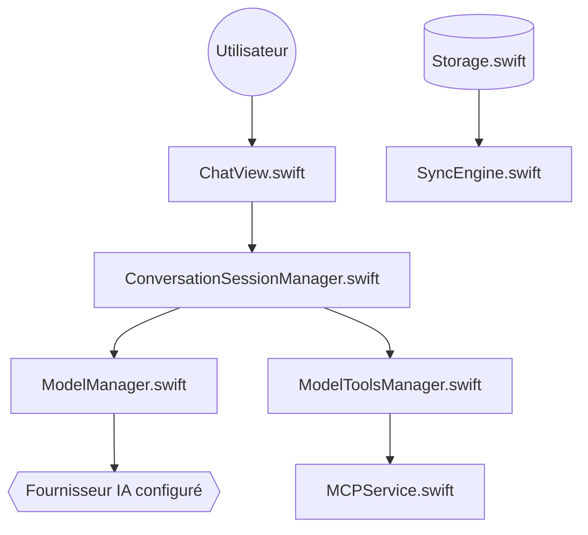

# Lakr233/FlowDown

> Client de chat IA natif pour iPhone, iPad et Mac, qui n'envoie aucune donnée au développeur.

## Le problème
Les clients de chat IA officiels centralisent tes données et ne laissent pas brancher tes propres modèles.

## Ce que ça fait vraiment
Chat Swift et UIKit connecté à tout service compatible OpenAI, à des serveurs locaux (Ollama, LM Studio, LocalAI), à Apple Intelligence ou à un modèle MLX local. Pièces jointes, vision, audio, recherche web, outils et connexions MCP, modèles de prompts, synchronisation iCloud, intents Shortcuts et app de traduction. Le README annonce zéro collecte et aucune télémétrie.

## Comment c'est branché


## Essayer
```bash
# Aucune commande : application à installer depuis l'App Store ou TestFlight,
# puis ajouter un modèle (Apple Intelligence, MLX local ou fournisseur compatible OpenAI).
```

## Coût et pièges
Tarification en baisse, passage à la gratuité annoncé avec abonnement futur pour la personnalisation. Les modèles distants coûtent selon ton fournisseur. À configurer et tester toi-même, modèle par modèle.

## Ce que ce n'est pas
Pas un modèle ni un service : c'est uniquement l'interface. Réservé à l'écosystème Apple. Licence AGPL, non signalée ici par défaut.

## Alternatives
Aucune alternative nommée dans le README (Ollama, LM Studio, LocalAI sont cités comme backends).

## Pour toi
À surveiller : pratique pour tester tes modèles locaux ou compatibles OpenAI depuis Apple, à condition de ne pas avoir besoin d'autre plateforme.

