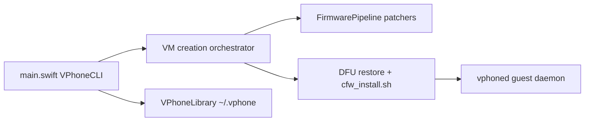

# Lakr233/vphone-cli

> macOS CLI that boots a virtual iPhone via Virtualization.framework, for iOS security researchers.

## The problem
Studying iOS without a physical device requires a virtual machine and a complex firmware pipeline.

## What it actually does
Prepares iPhone and cloudOS firmwares, patches the boot chain, restores via DFU, installs a CFW and launches the VM. Five patch variants (`less` to `exp`, from 4 to 141 patches; `jb` includes a full jailbreak). Control socket for screenshots, touch and clipboard, designed for AI-driven tests.

## How it is wired


## Trying it
```bash
brew install zqxwce/tap/vphone-cli
vphone-cli vm create myphone -V jb
vphone-cli vm launch myphone
```

## Cost and gotchas
Apple Silicon, macOS 15+, Xcode. Requires relaxing SIP/AMFI on the host (`csrutil disable`, AMFI boot-arg), which weakens the Mac's security. Does not work inside a nested VM.

## What it is not
Not a mainstream emulator: it is a research tool that bypasses Apple protections.

## Alternatives
No alternative cited in the README (vphone-mcp is cited for automation).

## For you
Ignore: niche iOS security research, requiring SIP/AMFI to be relaxed, unrelated to data/AI/MLOps.
