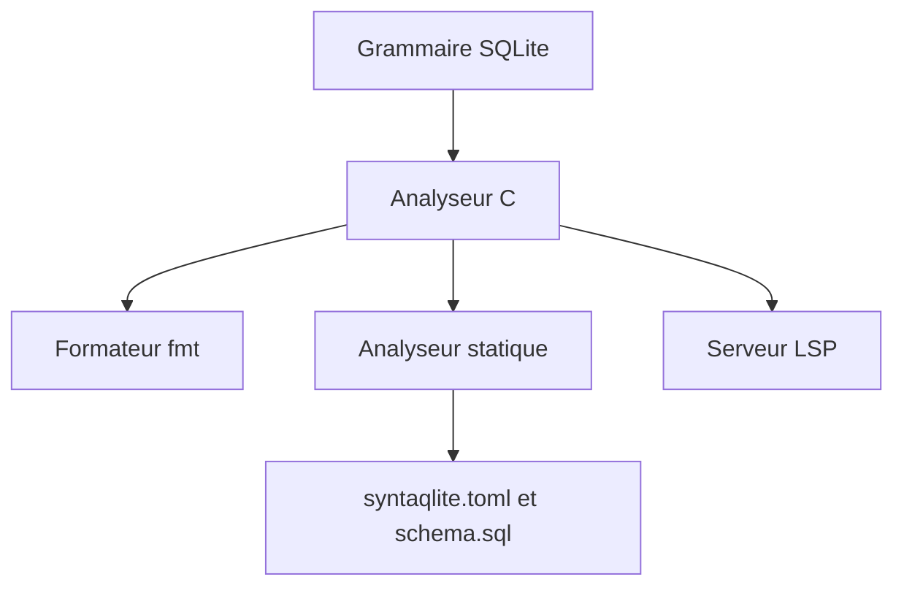

# LalitMaganti/syntaqlite

> Parser, formatter and language server for SQLite SQL, usable as a CLI, in an editor or as a library.

## The problem
SQL column or syntax errors only show up at runtime, and formatting varies from one developer to another.

## What it actually does
A C parser generated from SQLite's grammar preserves comments and whitespace. On top of it: a formatter (`fmt`), a static analyzer that checks queries against a schema file without a database, and an LSP server. It targets a specific SQLite version. Available in Rust, Python, JavaScript and C. It is 0.x: APIs may change.

## How it is wired
Simplified diagram based on the sheet, no diagram provided.


## Trying it
```bash
pip install syntaqlite
syntaqlite fmt -e "select id,name,email from users where active=1 and role='admin' order by name"
syntaqlite analyze --schema schema.sql -e "SELECT nme, email FROM users"
syntaqlite --sqlite-version 3.32.0 analyze -e "DELETE FROM users WHERE id = 1 RETURNING *;"
```

## Cost and gotchas
Free, no account. Version 0.x: the command-line interface may change before 1.0. The `curl | python3` installer runs a remote script.

## What it is not
It is not a tool for PostgreSQL, MySQL or other dialects (except SQLite-derived dialects). It does not connect to any database.

## Alternatives
Not documented in the README.

## For you
Adopt: a database-free SQL check in CI and uniform formatting are directly useful if you write SQLite or DuckDB-like queries, especially as it is already used by Perfetto.
