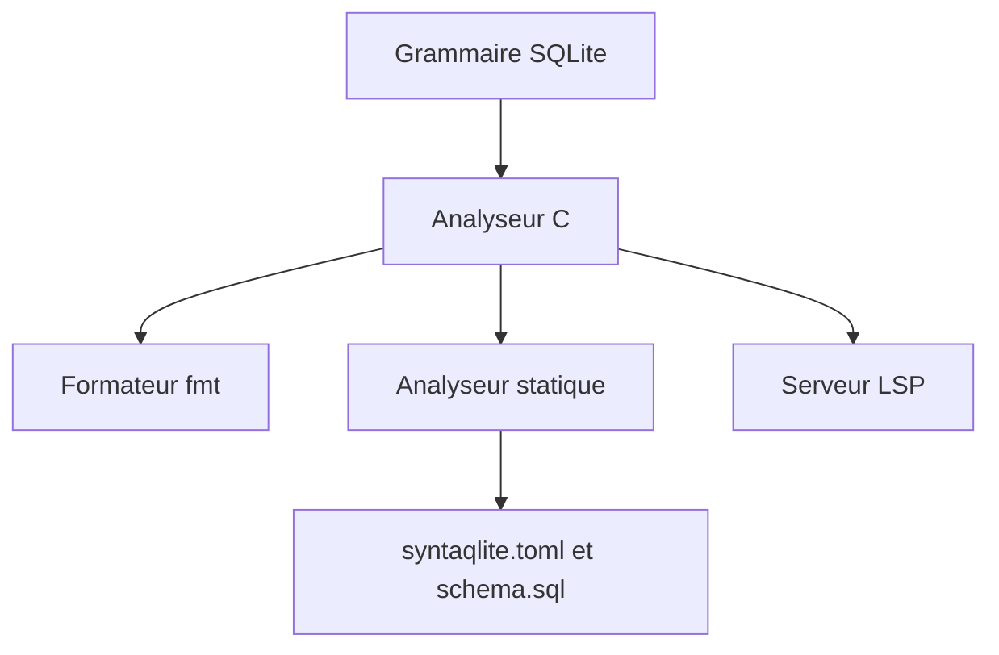

# LalitMaganti/syntaqlite

> Analyseur, formateur et serveur de langage pour le SQL de SQLite, utilisable en CLI, éditeur ou bibliothèque.

## Le problème
Les erreurs de colonne ou de syntaxe SQL ne se voient qu'à l'exécution, et le formatage varie d'un développeur à l'autre.

## Ce que ça fait vraiment
Un analyseur C généré depuis la grammaire de SQLite conserve commentaires et espaces. Dessus : un formateur (`fmt`), un analyseur statique qui vérifie les requêtes contre un fichier de schéma sans base, et un serveur LSP. Il cible une version précise de SQLite. Disponible en Rust, Python, JavaScript et C. Il est en 0.x : les API peuvent changer.

## Comment c'est branché
Schéma simplifié d'après la fiche, sans diagramme fourni.


## Essayer
```bash
pip install syntaqlite
syntaqlite fmt -e "select id,name,email from users where active=1 and role='admin' order by name"
syntaqlite analyze --schema schema.sql -e "SELECT nme, email FROM users"
syntaqlite --sqlite-version 3.32.0 analyze -e "DELETE FROM users WHERE id = 1 RETURNING *;"
```

## Coût et pièges
Gratuit, sans compte. Version 0.x : l'interface en ligne de commande peut changer avant la 1.0. L'installeur par `curl | python3` exécute un script distant.

## Ce que ce n'est pas
Ce n'est pas un outil pour PostgreSQL, MySQL ou autres dialectes (sauf dialectes dérivés de SQLite). Il ne se connecte à aucune base.

## Alternatives
Non documenté dans le README.

## Pour toi
À adopter : un contrôle SQL en CI sans base et un formatage uniforme servent directement si tu écris des requêtes SQLite ou DuckDB-like, d'autant qu'il est déjà utilisé par Perfetto.

