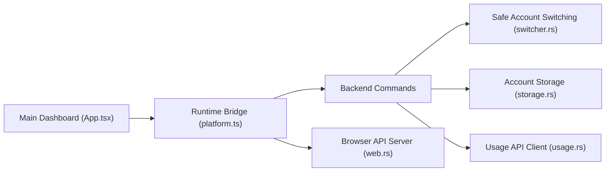

# Lampese/codex-switcher

> Desktop application to switch between several OpenAI Codex accounts and track their quota.

## The problem
With several Codex accounts, switching accounts by hand and monitoring the 5-hour and weekly limits is tedious.

## What it actually does
The application stores several accounts (ChatGPT OAuth login or `auth.json` import), switches from the window or the system tray and displays limits, credits and usage statistics. It saves the active account's token before switching, so as not to lose the session. A "warm-up" sends a minimal request to start the quota window, manually or at fixed times.

## How it is wired


## Trying it
```bash
git clone https://github.com/Lampese/codex-switcher.git
cd codex-switcher
pnpm install
pnpm tauri dev
pnpm tauri build
pnpm lan
```

## Cost and gotchas
Free, but the macOS builds are not notarized (remove the quarantine by hand). `pnpm lan` listens on 0.0.0.0:3210: do not expose this port without protection, since the application handles tokens. 80 open issues according to the catalog.

## What it is not
It is not an account-pooling tool: the README forbids sharing, circumventing OpenAI's terms of use and pooling credentials. It itself begins with "perhaps you no longer need this software".

## Alternatives
No alternative named in the README.

## For you
Ignore: it is for juggling quotas across personal accounts, with a risk with regard to OpenAI's terms, and the README itself suggests it may have become unnecessary.
