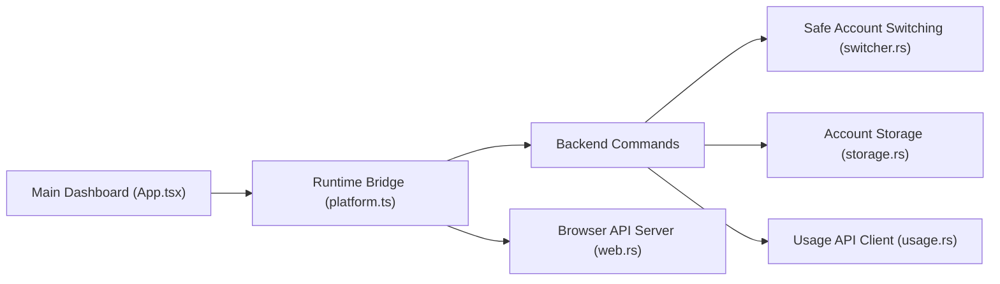

# Lampese/codex-switcher

> Application de bureau pour basculer entre plusieurs comptes OpenAI Codex et suivre leur quota.

## Le problème
Avec plusieurs comptes Codex, changer de compte à la main et surveiller les limites de 5 heures et hebdomadaires est fastidieux.

## Ce que ça fait vraiment
L'application stocke plusieurs comptes (connexion ChatGPT OAuth ou import de `auth.json`), bascule depuis la fenêtre ou la barre système et affiche limites, crédits et statistiques d'usage. Elle sauvegarde le jeton du compte actif avant de changer, pour ne pas perdre la session. Un « warm-up » envoie une requête minimale pour démarrer la fenêtre de quota, manuellement ou à heures fixes.

## Comment c'est branché


## Essayer
```bash
git clone https://github.com/Lampese/codex-switcher.git
cd codex-switcher
pnpm install
pnpm tauri dev
pnpm tauri build
pnpm lan
```

## Coût et pièges
Gratuit, mais les versions macOS ne sont pas notariées (retirer la quarantaine à la main). `pnpm lan` écoute sur 0.0.0.0:3210 : n'expose pas ce port sans protection, car l'application manipule des jetons. 80 issues ouvertes d'après le catalogue.

## Ce que ce n'est pas
Ce n'est pas un outil de mutualisation de comptes : le README interdit partage, contournement des conditions d'utilisation d'OpenAI et mise en commun d'identifiants. Il commence lui-même par « perhaps you no longer need this software ».

## Alternatives
Aucune alternative nommée dans le README.

## Pour toi
À ignorer : il sert à jongler entre quotas de comptes personnels, avec un risque vis-à-vis des conditions d'OpenAI, et le README suggère lui-même qu'il est peut-être devenu inutile.

