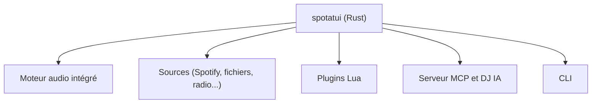

# LargeModGames/spotatui

> Rust terminal music player with seven sources including Spotify.

## The problem
Streaming clients are heavy, and your sources (Spotify, local files, radio) stay in separate applications.

## What it actually does
A terminal player with a desktop version in preview. It plays Spotify (Premium required), local files, Subsonic, radio, YouTube, Qobuz and Apple Music. It offers synced lyrics, an audio visualizer, a mixed queue, Lua plugins, a CLI and an AI DJ or a DJ via MCP. Windows binaries are signed via SignPath.

## How it is wired
Simplified diagram based on the card, no diagram provided.



## Trying it
```bash
curl -fsSL https://spotatui.com/install.sh | bash
cargo install --locked spotatui
spotatui --help
```

## Cost and gotchas
Spotify requires a Premium account, Qobuz a paid account, YouTube needs `yt-dlp`. `cargo install` only builds Spotify support with no options.

## What it is not
It is not a music service: it plugs into your accounts. It is not related to data or AI, apart from the DJ feature.

## Alternatives
- spotify-tui: the project spotatui originated from.

## For you
Ignore for a data / AI / MLOps profile: it is a personal music player, unrelated to your work.
