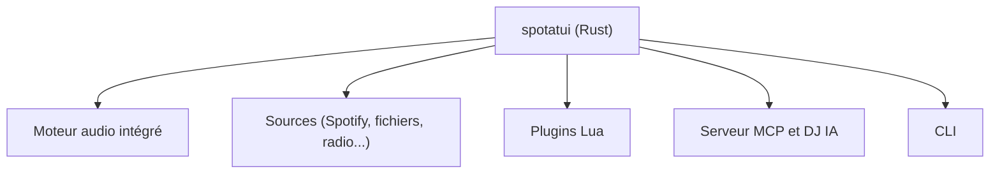

# LargeModGames/spotatui

> Lecteur de musique en Rust pour le terminal, avec sept sources dont Spotify.

## Le problème
Les clients de streaming sont lourds, et tes sources (Spotify, fichiers locaux, radios) restent dans des applications séparées.

## Ce que ça fait vraiment
Un lecteur en terminal avec une version bureau en préversion. Il joue Spotify (Premium requis), fichiers locaux, Subsonic, radios, YouTube, Qobuz et Apple Music. Il offre paroles synchronisées, visualiseur audio, file d'attente mixte, plugins Lua, une CLI et un DJ IA ou un DJ via MCP. Les binaires Windows sont signés via SignPath.

## Comment c'est branché
Schéma simplifié d'après la fiche, sans diagramme fourni.



## Essayer
```bash
curl -fsSL https://spotatui.com/install.sh | bash
cargo install --locked spotatui
spotatui --help
```

## Coût et pièges
Spotify demande un compte Premium, Qobuz un compte payant, YouTube a besoin de `yt-dlp`. `cargo install` ne compile que Spotify sans options.

## Ce que ce n'est pas
Ce n'est pas un service de musique : il se branche sur tes comptes. Ce n'est pas lié à la data ou à l'IA, hormis la fonction DJ.

## Alternatives
- spotify-tui : projet dont spotatui est issu.

## Pour toi
À ignorer pour un profil data / IA / MLOps : c'est un lecteur de musique personnel, sans lien avec ton travail.

