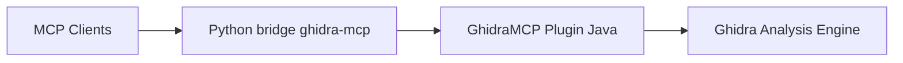

# LaurieWired/GhidraMCP

> MCP server and Ghidra extension that let an LLM analyze and rename binary code.

## The problem
Reverse-engineering a binary in Ghidra is slow, and an LLM has no access to the decompiler.

## What it actually does
A Java extension for Ghidra 12.1.4 exposes a local HTTP server (port 8080 by default); a Python bridge `ghidra-mcp` translates it into MCP tools: decompilation, method listing, classes, imports and exports, automatic renaming. A headless mode (PyGhidra) can import and analyze a binary on its own.

## How it is wired


## Trying it
```bash
claude mcp add ghidra -- uvx --from git+https://github.com/LaurieWired/GhidraMCP ghidra-mcp --ghidra-server http://127.0.0.1:8080/
uvx --python 3.13 --from "ghidra-mcp[headless] @ git+https://github.com/LaurieWired/GhidraMCP" ghidra-mcp --headless --binary /path/to/target
```

## Cost and gotchas
Ghidra 12.1.4 to install and extension to enable. Headless mode requires Python 3.10 to 3.13, `GHIDRA_INSTALL_DIR` and, on macOS, compiling the decompiler. Building from source with Gradle and Java 21.

## What it is not
Not a decompiler: it depends entirely on Ghidra. The README only says that "theoretically, any MCP client" works.

## Alternatives
No alternative named in the README.

## For you
Ignore for your data/MLOps profile: the use is binary reverse engineering; keep in mind only if you analyze security binaries.
