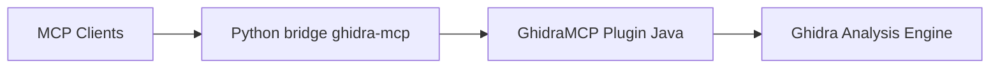

# LaurieWired/GhidraMCP

> Serveur MCP et extension Ghidra qui laissent un LLM analyser et renommer du code binaire.

## Le problème
La rétro-ingénierie d'un binaire dans Ghidra est longue, et un LLM n'a pas accès au décompilateur.

## Ce que ça fait vraiment
Une extension Java pour Ghidra 12.1.4 expose un serveur HTTP local (port 8080 par défaut) ; un pont Python `ghidra-mcp` le traduit en outils MCP : décompilation, liste de méthodes, classes, imports et exports, renommage automatique. Un mode sans interface (PyGhidra) peut importer et analyser un binaire seul.

## Comment c'est branché


## Essayer
```bash
claude mcp add ghidra -- uvx --from git+https://github.com/LaurieWired/GhidraMCP ghidra-mcp --ghidra-server http://127.0.0.1:8080/
uvx --python 3.13 --from "ghidra-mcp[headless] @ git+https://github.com/LaurieWired/GhidraMCP" ghidra-mcp --headless --binary /path/to/target
```

## Coût et pièges
Ghidra 12.1.4 à installer et extension à activer. Le mode sans interface exige Python 3.10 à 3.13, `GHIDRA_INSTALL_DIR` et, sous macOS, la compilation du décompilateur. Construction depuis les sources avec Gradle et Java 21.

## Ce que ce n'est pas
Pas un décompilateur : il dépend entièrement de Ghidra. Le README dit seulement que « théoriquement, tout client MCP » fonctionne.

## Alternatives
Aucune alternative nommée dans le README.

## Pour toi
À ignorer pour ton profil data/MLOps : l'usage est la rétro-ingénierie de binaires ; à retenir seulement si tu analyses des binaires de sécurité.

