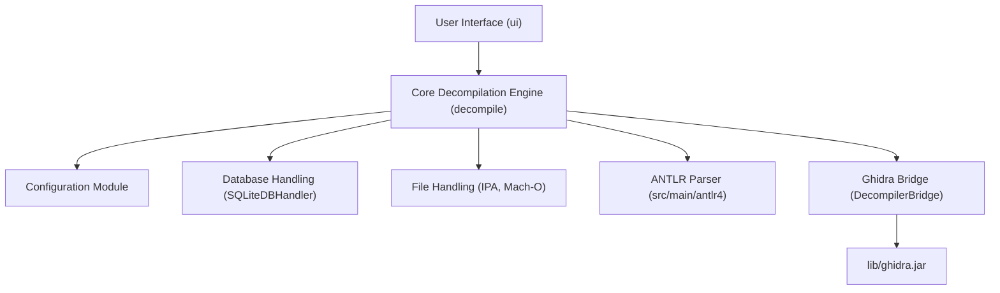

# LaurieWired/Malimite

> iOS and macOS decompiler built on Ghidra, for researchers analyzing IPA files and bundles.

## The problem
Reading the code of an Apple application from an IPA or a bundle means juggling between Ghidra, decoded resources and poorly reconstructed Swift classes.

## What it actually does
Java interface that opens an IPA or a bundle, decodes iOS resources, runs Ghidra decompilation through a bridge (DecompilerBridge) and reconstructs Swift classes. It avoids decompiling libraries. An LLM-based method translation is built in (AIBackend module according to the code). Metadata goes into a SQLite database.

## How it is wired

## Trying it
No command documented in the README: a precompiled JAR is provided on the Releases page, detailed steps are in the Wiki.

## Cost and gotchas
Java required (Maven project), not in the prerequisites list. The LLM translation provider and its cost are not documented in the README; last push in August 2025.

## What it is not
Not an attack tool: it reads code, it does not modify it. Not a standalone decompiler: it depends on Ghidra. The quality of the reconstructed Swift code is not measured in the README.

## Alternatives
No alternative cited in the README (Ghidra is the underlying building block).

## For you
Ignore: reverse engineering of Apple applications is outside the data / AI / MLOps scope, except for an occasional mobile audit need.
