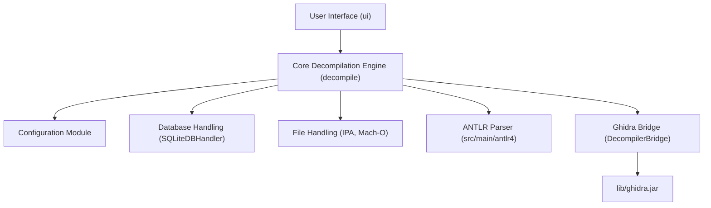

# LaurieWired/Malimite

> Décompilateur iOS et macOS bâti sur Ghidra, pour chercheurs qui analysent des fichiers IPA et des bundles.

## Le problème
Lire le code d'une application Apple à partir d'un IPA ou d'un bundle demande de jongler entre Ghidra, les ressources décodées et les classes Swift mal reconstruites.

## Ce que ça fait vraiment
Interface Java qui ouvre un IPA ou un bundle, décode les ressources iOS, lance la décompilation Ghidra via un pont (DecompilerBridge) et reconstruit les classes Swift. Elle évite de décompiler les bibliothèques. Une traduction de méthodes par LLM est intégrée (module AIBackend d'après le code). Les métadonnées vont dans une base SQLite.

## Comment c'est branché

## Essayer
Aucune commande documentée dans le README : un JAR précompilé est fourni dans la page Releases, les étapes détaillées sont dans le Wiki.

## Coût et pièges
Java requis (projet Maven), hors liste des prérequis. Le fournisseur de la traduction LLM et son coût ne sont pas documentés dans le README ; dernier push en août 2025.

## Ce que ce n'est pas
Pas un outil d'attaque : il lit du code, il n'en modifie pas. Pas un décompilateur autonome : il dépend de Ghidra. La qualité du code Swift reconstruit n'est pas mesurée dans le README.

## Alternatives
Aucune alternative citée dans le README (Ghidra est la brique sous-jacente).

## Pour toi
Ignorer : la rétro-ingénierie d'applications Apple est hors du périmètre data / IA / MLOps, sauf besoin d'audit mobile ponctuel.

