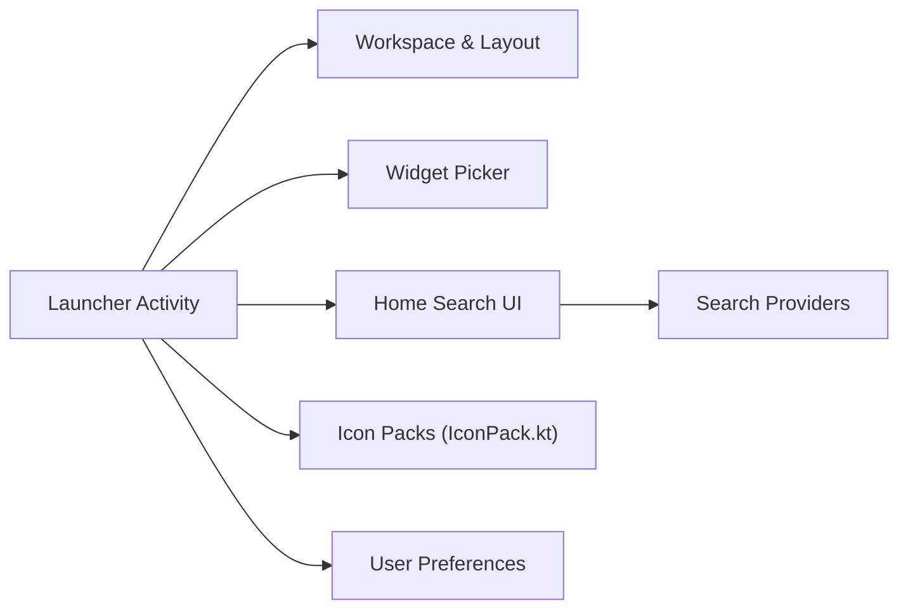

# LawnchairLauncher/lawnchair

> Android app launcher, derived from Launcher3, bringing Pixel Launcher features and customization.

## The problem
Android's stock launcher offers few settings for icons, fonts and colors.

## What it actually does
Lawnchair 16 starts from Launcher3 (Android 16): Material 3 Expressive theme, At a Glance widget (Smartspacer), global search (apps, contacts, web), customizable icon packs and fonts, QuickSwitch for the Recents screen (root required on Android 15-16). The architecture is only partially detailed.

## How it is wired

## Trying it
No documented command: the README offers downloads (Play Store, Obtainium, GitHub, nightly.link).

## Cost and gotchas
Free. The Play Store version installs as a separate app, with reduced features. Development builds may be unstable. 782 open issues.

## What it is not
Not an app usable on iOS or outside Android. Branch 16 is still under development.

## Alternatives
No alternative named in the README.

## For you
Ignore: an Android launcher has no connection to your data/AI/MLOps work, and the license remains to be verified.
