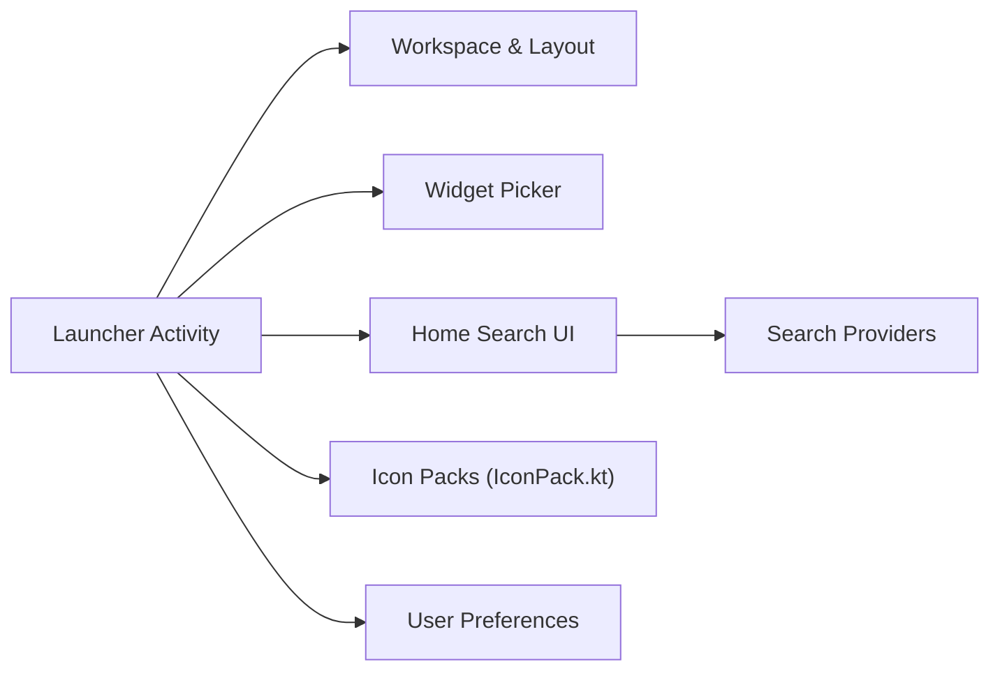

# LawnchairLauncher/lawnchair

> Lanceur d'applications Android, dérivé de Launcher3, qui apporte les fonctions du Pixel Launcher et de la personnalisation.

## Le problème
Le lanceur d'origine d'Android offre peu de réglages d'icônes, de polices et de couleurs.

## Ce que ça fait vraiment
Lawnchair 16 part de Launcher3 (Android 16) : thème Material 3 Expressive, widget At a Glance (Smartspacer), recherche globale (applis, contacts, web), icon packs et polices personnalisables, QuickSwitch pour l'écran Récents (root requis sur Android 15-16). L'architecture n'est que partiellement détaillée.

## Comment c'est branché

## Essayer
Aucune commande documentée : le README propose des téléchargements (Play Store, Obtainium, GitHub, nightly.link).

## Coût et pièges
Gratuit. La version Play Store s'installe comme une appli distincte, aux fonctions réduites. Les builds de développement peuvent être instables. 782 issues ouvertes.

## Ce que ce n'est pas
Pas une application utilisable sur iOS ni hors Android. La branche 16 est encore en développement.

## Alternatives
Aucune alternative nommée dans le README.

## Pour toi
Ignorer : un lanceur Android n'a pas de rapport avec ton métier data/IA/MLOps, et la licence reste à vérifier.

