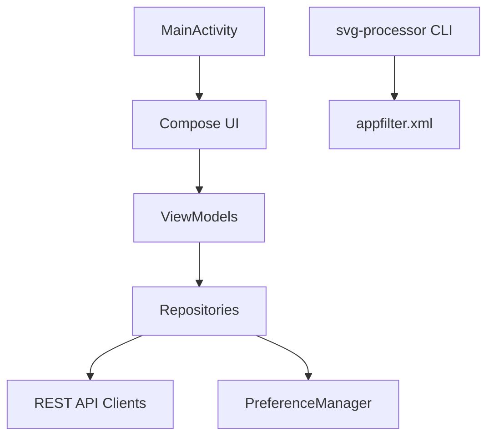

# LawnchairLauncher/lawnicons

> Community Android icon pack, with themed icons, for Lawnchair and most third-party launchers.

## The problem
Not all Android apps have a consistent themed icon; launchers need a pack that provides one.

## What it actually does
An Android application (Kotlin, Jetpack Compose, MVVM) provides icons to apply in the launcher. Contributors add icons through PRs, and users can request them from within the app. An `svg-processor` tool and Python scripts prepare the resources, while GitHub Actions builds the APKs.

## How it is wired

## Trying it
No command documented in the README. In Lawnchair: Home Settings, General, Icon Style, to enable themed icons.

## Cost and gotchas
Free. The Play Store version installs as an app separate from those of other sources. Contributions are limited: 5 icons per PR, and 100 icons reviewed per quarter.

## What it is not
It is not a launcher: you need a compatible launcher, such as Lawnchair. It is not a development tool, apart from contributing icons.

## Alternatives
No alternative named in the README.

## For you
Ignore: an Android icon pack unrelated to data, AI or MLOps.
