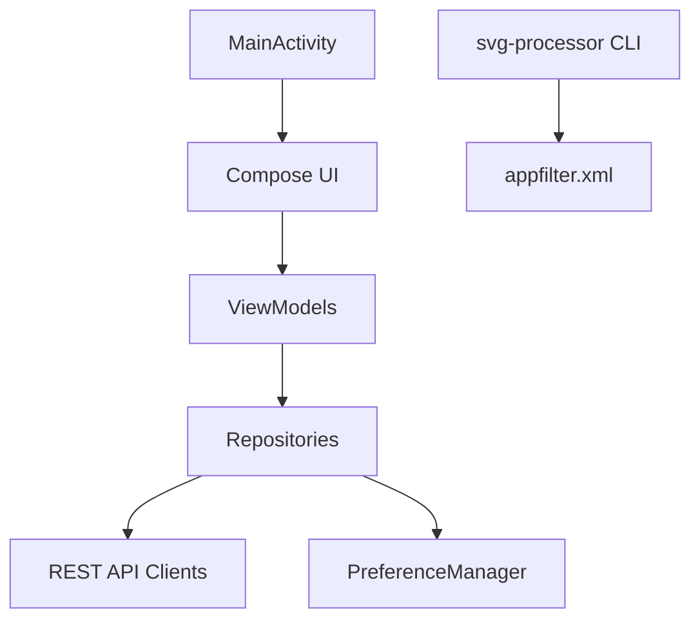

# LawnchairLauncher/lawnicons

> Pack d'icônes Android communautaire, avec icônes thématiques, pour Lawnchair et la plupart des lanceurs tiers.

## Le problème
Les applications Android n'ont pas toutes d'icône thématique cohérente ; les lanceurs ont besoin d'un pack qui la fournit.

## Ce que ça fait vraiment
Une application Android (Kotlin, Jetpack Compose, MVVM) fournit des icônes à appliquer dans le lanceur. Les contributeurs ajoutent des icônes par PR, et les utilisateurs peuvent en demander depuis l'application. Un outil `svg-processor` et des scripts Python préparent les ressources, tandis que GitHub Actions compile les APK.

## Comment c'est branché

## Essayer
Aucune commande documentée dans le README. Dans Lawnchair : Home Settings, General, Icon Style, pour activer les icônes thématiques.

## Coût et pièges
Gratuit. La version du Play Store s'installe comme une application distincte des autres sources. Les contributions sont limitées : 5 icônes par PR, et 100 icônes relues par trimestre.

## Ce que ce n'est pas
Ce n'est pas un lanceur : il faut un lanceur compatible, comme Lawnchair. Ce n'est pas un outil de développement, hors contribution d'icônes.

## Alternatives
Aucune alternative nommée dans le README.

## Pour toi
À ignorer : un pack d'icônes Android sans rapport avec data, IA ou MLOps.

