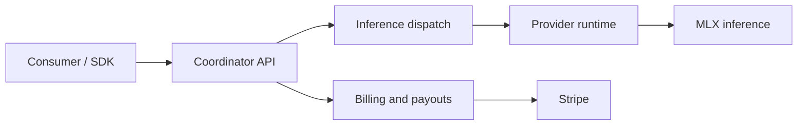

# Layr-Labs/d-inference

> Decentralized private inference network on Apple Silicon Macs, OpenAI-compatible, for consumers and Mac owners.

## The problem
LLM inference goes through expensive intermediaries, while millions of Macs sit idle. The risk: the Mac's host must not be able to read the prompts.

## What it actually does
A Go coordinator (Confidential VM) authenticates, routes, bills and relays NaCl Box-encrypted requests to providers. These are Macs running MLX in-process and connecting outbound over WebSocket. The API accepts OpenAI and Anthropic. Hardware attestation goes through Secure Enclave, MDM and APNs. Announced status: Public Alpha.

## How it is wired


## Trying it
```bash
curl https://api.darkbloom.dev/v1/chat/completions \
  -H "Authorization: Bearer sk-db-..." \
  -H "Content-Type: application/json" \
  -d '{"model":"gemma-4-26b","messages":[{"role":"user","content":"Hello!"}],"stream":true}'
curl -fsSL https://api.darkbloom.dev/install.sh | bash
darkbloom start
```

## Cost and gotchas
Per-token billing (fallback: $0.05/M input, $0.20/M output), deposit via Stripe. The text is visible in clear in the coordinator's encrypted memory, so it is not absolutely end-to-end. The README announces breaking changes and outages.

## What it is not
It is not "zero trust": the README states that the coordinator transiently sees the text. No embeddings endpoint (404). Depends on the hosted service api.darkbloom.dev.

## Alternatives
The README only compares against conventional hosted APIs; no alternative repository named.

## For you
Worth watching: an interesting idea for cheap inference, but alpha, SaaS-dependent and with a license to verify; do not use it on sensitive data.
